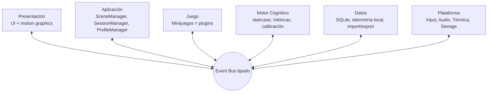

# NeuroFit — Playbook de desarrollo con Agente de IA

**Documento operativo maestro.** Este playbook contiene TODO lo necesario para que un agente de IA desarrolle NeuroFit de forma autónoma y verificable: contexto del producto, arquitectura de referencia, requisitos completos, convenciones, backlog priorizado, criterios de aceptación y protocolos de verificación. Un desarrollador humano actúa como revisor; el agente ejecuta.

---

## 1. Misión del agente y reglas de compromiso

Estás constriendo **NeuroFit**: una plataforma de entrenamiento cognitivo de código abierto, sucesora espiritual de *Dr. Kawashima's Brain Training*, multiplataforma (Linux, Windows, Android), con calidad visual premium en hardware de bajo consumo.

### Reglas de compromiso (no negociables)

1. **Verifica antes de afirmar.** Nunca declares una tarea como completa sin ejecutar su verificación (§10). "Debería funcionar" no es un resultado aceptable.
2. **Commits atómicos y descriptivos.** Una tarea del backlog = un commit (o PR). Si una tarea requiere más de ~400 líneas cambiadas, divídela.
3. **Presupuesto de rendimiento como contrato.** Ningún cambio puede romper los presupuestos de §4.3. Todo código de gameplay debe mantenerse dentro del presupuesto de frame.
4. **GLES2 o nada.** Ninguna característica puede depender de GLES3/Vulkan exclusivamente. Si dudas, asumir que solo GLES2 está disponible.
5. **Nada de dependencias propietarias.** Solo código MIT/GPL-compatible y activos CC0/CC-BY. Toda dependencia nueva debe documentar licencia y justificación en este playbook (sección 12).
6. **EventBus como única vía de comunicación entre capas.** Un minijuego que acceda a otro nodo fuera de su rama sin pasar por el bus es un bug de arquitectura, aunque funcione.
7. **Preguntar solo cuando el playbook no responde.** Ante ambigüedad, elegir la opción que minimice el costo de revertir y documentar la decisión en `docs/adr/` (Decision Records numerados).
8. **Offline-first.** Ninguna característica requiere red, cuenta o servidor para funcionar. Telemetría local con opt-in explícito.
9. **Al final de cada tarea:** actualizar CHANGELOG, ejecutar verificación, y reportar resultados con números (ms de frame, errores de test, warnings de Godot).

### Herramientas permitidas
- Godot 3.5 (editor headless `godot --headless` para CI/verificación de scripts).
- GDScript (GDNative/Python solo para tooling de assets, nunca en runtime del juego).
- Git convencional; ramas `feature/`, `fix/`, `chore/`.

---

## 2. Contexto del producto

### 2.1 Visión
Entrenamiento cognitivo diario de 10–15 minutos, sesiones cortas de 2–5 minutos por ejercicio, con feedback visual y sonoro "jugoso", progreso por dominios cognitivos y racha diaria. Estética *modern clean* estilo dashboard SaaS premium; animación con impacto y profundidad (hit-pause, easing con intención, parallax por capas). Todo open source: código MIT, activos CC0.

### 2.2 Plataformas objetivo (en orden de prioridad)
1. **Linux PC** (hardware mínimo de referencia: AMD A8-7410, Radeon R5 GCN 1.1, 4 GB RAM) — el baseline de rendimiento.
2. **Android** (min. API 24, OpenGL ES 2.0, 2 GB RAM, ej. Snapdragon 425 / Helio A22).
3. **Windows** (OpenGL/GLES2 vía drivers Adrenalin heredados).

### 2.3 Público
Adultos 25–55 que recuerdan Brain Training; usuarios de hardware modesto (filosofía open source: accesible para todos). Jugar en español es el caso principal; el texto de UI debe estar externalizado para i18n desde el día 1.

### 2.4 Los 5 minijuegos de v1.0
| ID | Ejercicio | Dominio cognitivo | Input principal |
|---|---|---|---|
| `calc.x20` | Cálculos ×20 (piloto) | Velocidad de procesamiento | Trazo táctil / teclado |
| `stroop.voice` | Test de Stroop | Control inhibitorio | Voz (Vosk) + tap |
| `head.count` | Head Count (conteo de personas) | Memoria a corto plazo | Tap |
| `workmem.adaptive` | Memoria de trabajo adaptativa (n-back ligero) | Memoria de trabajo | Tap |
| `symbols.speed` | Velocidad de símbolos (matching) | Velocidad / atención | Tap |

**Categorías de color del sistema de dominios:** procesamiento = coral `#FF6B6B`, memoria = índigo `#6C63FF`, autocontrol = verde `#4ECDC4`, atención dual = ámbar `#FFB84C`.

---

## 3. Arquitectura de referencia (resumen ejecutivo)

Documento madre: "NeuroFit — Documento de Arquitectura v1.0". Regla del agente: ante conflicto entre memoria y documento, el documento manda; si el documento contradice este playbook, este playbook manda y se registra un ADR.

### 3.1 Las 6 capas + Event Bus



**Invariante estructural:** ninguna capa llama a otra directamente; todo mensaje es una señal del EventBus. Los minijuegos no conocen la plataforma; el Motor Cognitivo no conoce Godot (GDScript puro, sin nodos).

### 3.2 Autoloads y orden de carga (project.godot)

```ini
[autoload]
EventBus="*res://autoload/EventBus.gd"
MotionManager="*res://autoload/MotionManager.gd"
AudioManager="*res://autoload/AudioManager.gd"
PlatformSupervisor="*res://autoload/PlatformSupervisor.gd"
CognitiveEngine="*res://autoload/CognitiveEngine.gd"
PluginLoader="*res://autoload/PluginLoader.gd"
SessionManager="*res://autoload/SessionManager.gd"
SceneManager="*res://autoload/SceneManager.gd"
```

Configuración de proyecto: resolución de referencia 1280×720, driver GLES2, vsync activo, `config/name="NeuroFit"`. Export Android: min API 24, armv7+arm64, AAB con asset packs on-demand.

### 3.3 Estructura de carpetas (contrato)
```
autoload/          # los 8 autoloads
core/
  motion_presets/  # .tres de easing (diseño sin código)
  audio_presets/   # .tres de mezcla y capas musicales
  input/
plugins/
  calc_x20/        # minigame.json + main.tscn + main.gd
  stroop_voice/
  head_count/
  workmem_adaptive/
  symbols_speed/
ui/
  dashboard/
  transitions/    # SceneManager con cross-fade (nunca pantalla negra)
  widgets/
assets/
  icons/           # SVG maestros (Inkscape) + export script
  fonts/
  audio/
  spritesheets/
scenes/            # splash, shell de la app
data/              # schema SQLite + migraciones
tests/
  cognitive/       # GDScript puro, corrientes sin editor
docs/
  adr/             # Decision Records
i18n/              # strings.es.csv, strings.en.csv
```

### 3.4 El contrato de plugin (minigame.json)
Cada minijuego es un paquete autocontenido con escena + manifiesto. Campos obligatorios: `id`, `version`, `engine_min`, `category`, `difficulty_range`, `session_shape` (min/max seg), `input` (array de `"touch_trace"|"tap"|"keyboard"|"voice"`), `render_profile`, `scene` (path), `cognitive_hooks` (métricas + estrategia adaptativa). El PluginLoader valida contra esta lista; un manifiesto inválido se ignora con warning, **nunca tira la app**.

Estados obligatorios de cada minijuego (State pattern): `INTRO → PLAYING → RESULTS`, con pausa serializable (`NOTIFICATION_PAUSED` / `NOTIFICATION_WM_FOCUS_OUT`).

---

## 4. Presupuestos y perfiles (contrato de rendimiento)

### 4.1 Presupuesto de frame (16.6 ms objetivo)
| Partida | Límite |
|---|---|
| UI + motion graphics | ≤ 4 ms |
| Lógica de minijuego | ≤ 3 ms |
| CognitiveEngine (event-driven) | ≤ 0.5 ms |
| GC / sistema | ≤ 2 ms |
| Render (GPU, GLES2) | resto |

### 4.2 Presupuesto de recursos
- **Audio:** música = OGG Vorbis mono, streaming, loops 15–30 s; SFX = WAV corto precargado en RAM. Un solo atlas de spritesheet por sistema de partículas (1 draw call por burst).
- **Iconos:** un SVG maestro por icono, rasterizado en runtime a la densidad del dispositivo.
- **TweenPool:** máx 2 tweens activos por widget; prioridad `impact > transition > ambient`.

### 4.3 Perfiles de calidad (conmutables en runtime por ThermalService)
| Parámetro | Low (A8-7410 / gama baja) | High |
|---|---|---|
| Resolución render | 720p escalada | Nativa ≤1080p |
| Partículas | pool 128 | pool 512 + trails |
| Post-procesado | FXAA + bloom sutil | + vignette + gradiente |
| FPS objetivo | 60 → 30 bajo alerta | 60 |

**Invariante:** degradar perfil jamás produce artefactos visibles (elementos huérfanos, flashes negros).

---

## 5. Sistema de animación (contrato de motion)

Principio: la animación es feedback cognitivo, no decoración.

| Contexto | Curva | Duración |
|---|---|---|
| Entrada de widget | ease_out_back (overshoot) | 300 ms |
| Respuesta correcta | ease_out_elastic escalonada | 400 ms + partículas |
| Error (sin castigo) | ease_in_out_quad + shake ±4px | 250 ms |
| Transición de escena | ease_in_out_cubic cross-fade | 350 ms |
| Ambient (breathing) | senoidal | ciclo 3 s |

Reglas:
- **Hit-pause de 40–60 ms al aciertar** — obligatorio, acotado, siempre reanuda el árbol.
- Animación ambient en shaders (uniform de tiempo): costo CPU ≈ 0.
- Desenfoque **precalculado** (sprites ya difuminados); prohibido blur en runtime.
- Sombras blob con alpha animado 0→1 en 150 ms al "aterrizar" widgets.
- Curvas y timings viven en `core/motion_presets/*.tres` — el agente crea los .tres, no hardcodea números en minijuegos.

---

## 6. Audio (contrato sonoro)

Identidad: **lo-fi cognitivo**. La música nunca compite con la concentración.

- **Música generativa por capas:** 3–4 capas (base rítmica, pad, melodía, textura) que entran/salen según eventos del bus. Racha → entra melodía; 3 errores → solo pad.
- **Tempo por dificultad:** nivel 1 ≈ 70 BPM, nivel 8 ≈ 92 BPM.
- **SFX con pitch variation** ±3–5% en cada reproducción; SFX de acierto en escala musical real (do-mi-sol) para que las rachas suenen melódicas; el pitch sube con la racha.
- **Eventos SFX mínimos:** acierto, error (grave suave, jamás buzzer), racha, cambio de dificultad, sello diario (mini-fanfarria 3 s), UI tap/hover, chime de micrófono activo en Stroop.
- **AudioManager (autoload):** pool de AudioStreamPlayers reciclados (patrón TweenPool); minijuegos NUNCA reproducen audio directo, solo emiten eventos; escucha `platform_thermal_warning` para bajar mezcla; en Android respeta audio focus (silenciar en llamadas).
- **Fuentes de activos:** Kenney audio (CC0), Pixabay, Freesound con filtro CC0, producción propia con LMMS/sfxr. Documentar licencia de cada archivo en `assets/audio/CREDITS.md`.

---

## 7. Iconografía y estética (contrato visual)

- **Iconos de línea:** stroke 2px, esquinas redondeadas, una tinta de acento; estilo Phosphor/Lucide; SVG maestros en Inkscape, export vía script.
- **Un concepto tangible por icono:** `calc.x20` = ábaco estilizado; `stroop.voice` = gota de tinta bicolor; `head.count` = siluetas de personas; `workmem.adaptive` = malla con nodos iluminados; `symbols.speed` = par de símbolos con check.
- **Color por dominio** (ver §2.4) — el mapa de color se aprende sin leer.
- **Micro-animación de icono:** 4–6 frames sprite al hover (el ábaco mueve una cuenta; la gota gotea).
- **Sello diario:** sello de cera estilizado, versión apagada (punteada) y encendida (relleno + brillo) — tratar como pieza central de colección.
- **Dígitos propios:** set de 10 dígitos + operadores redondeados dibujados a mano (Inkscape) para minijuegos de cálculo.
- **Tipografía:** identidad = Fredoka/Baloo 2 (títulos), Inter/Open Sans (cuerpo). Fuentes OFL de Google Fonts.
- **UI responsive:** contenedores Godot mapeados 1:1 desde Penpot (CSS Grid/Flex como referencia de diseño).
- **Accesibilidad (obligatoria en v1.0):** escalado de tipografía, modo alto contraste, Stroop con símbolos además de color (daltonismo), modo una mano en móvil.

---

## 8. Persistencia y datos

- **SQLite** local: tablas `PLAYER`, `SESSION`, `ANSWER`, `CALIBRATION` (ver ER del documento de arquitectura). Migraciones versionadas en `data/`.
- **Save incremental** tras cada respuesta (Android mata procesos sin aviso).
- **Export/import JSON** del progreso completo (respaldo entre dispositivos).
- **Reto diario procedural:** semilla derivada de la fecha (`seed = hash(fecha)`) — toda la comunidad juega el mismo desafío sin servidor.
- Telemetría local opt-in; jamás sale del dispositivo.

---

## 9. Cognitive Engine (contrato pedagógico)

- **Calibración inicial** reproducible (semilla fija) que fija el baseline por dominio.
- **Staircase adaptativo:** ventana móvil de 8 respuestas; objetivo de flujo ≈ 78% de acierto; sube máx 2 niveles por racha perfecta; baja 1 nivel si tasa < 63%; ventana nueva al cambiar nivel.
- **Progresión por dominios** (árbol ligero), no solo "edad cerebral" (mantenerla como número de resumen).
- **GDScript puro sin nodos**; los tests corren headless.
- Métricas por respuesta: `correct`, `time_ms`, `difficulty`, `stimulus_id`.

---

## 10. Protocolo de verificación (ejecutar en cada tarea)

El agente NO marca una tarea como hecha sin pasar estos checks y reportar sus resultados:

1. **Parseo del proyecto:** `godot --headless --check-only` sin errores.
2. **Tests headless:** `godot --headless -s tests/run_all.gd` → 0 fallos. Los tests del CognitiveEngine usan ventanas sintéticas de respuestas (sin editor).
3. **Presupuesto de frame:** el minijuego activo en una escena de estrés (60 estímulos generados) no supera el presupuesto de §4.1 medido con `Performance.get_monitor` durante 10 s.
4. **Sin warnings nuevos:** `godot --headless --quit` no agrega warnings respecto al commit anterior (warnings de Godot, no solo errores).
5. **PluginLoader robusto:** el agente debe inyectar un `minigame.json` malicioso/incompleto en test y verificar que se ignora con warning.
6. **Export Android:** cada hito termina con build AAB exitosa (`godot --headless --export-release android`). La primera build se realiza en la tarea A1 (ver backlog) y nunca después se permite romperla.
7. **Lints de convenio:** GDScript con indentación por tabs, nombres snake_case, señales en pasado/acción (`game_answer`), sin cadenas mágicas (constantes en `core/constants.gd`).

---

## 11. Backlog priorizado (el agente ejecuta en este orden)

### Fase A — Fundacional (cada tarea termina en commit verificado)
- **A1.** Proyecto Godot 3.5 vacío + autoloads esqueleto + export Android funcional (AAB de escena vacía). *Gate de riesgo: si esto no build-ea, no continuar.*
- **A2.** EventBus completo con señales tipadas + `emit_safe`.
- **A3.** PlatformSupervisor: frame-time monitor + degradación de perfil + input normalizado (touch/mouse/teclado → señales).
- **A4.** MotionManager: TweenPool + presets + hit-pause + regla de 2 tweens. Crear `core/motion_presets/*.tres`.
- **A5.** AudioManager: pool de players + mezcla por capas + degradación térmica + (Android) audio focus.
- **A6.** SceneManager: transición cross-fade nunca-negra con cola de carga.

### Fase B — Núcleo
- **B1.** CognitiveEngine: staircase + calibración + métricas, con suite de tests headless (gate: cobertura de escenarios de flujo).
- **B2.** PluginLoader + schema de manifiesto + test de manifiesto inválido.
- **B3.** SessionManager: SQLite + migraciones + save incremental + serialización de pausa.
- **B4.** Minijuego piloto `calc.x20` completo: generador de problemas por nivel, teclado numérico táctil + trazo vectorial, states, feedback con MotionManager + AudioManager.

### Fase C — Plataforma y contenido
- **C1.** Dashboard v1: selector de ejercicios (iconos + micro-animación), calendario de sellos, gráfico de rendimiento procedural (`Control` draw).
- **C2.** Calibración inicial + perfil de jugador + export/import JSON.
- **C3.** Reto diario procedural (semilla por fecha).
- **C4.** `stroop.voice` con Vosk local (modelo es, ~40 MB, descarga opcional) + fallback a tap.
- **C5.** `head.count`, **C6.** `workmem.adaptive`, **C7.** `symbols.speed`.
- **C8.** Música por capas completa + SFX set completo + CREDITS de licencias.
- **C9.** Iconografía completa (SVG maestros + export script) + set de dígitos propios + sello diario.

### Fase D — Beta
- **D1.** Accesibilidad (alto contraste, escalado, Stroop con símbolos, modo una mano).
- **D2.** i18n strings completos es/en.
- **D3.** Hito de rendimiento final: 60 FPS en A8-7410 y Android de gama baja con `calc.x20` a perfil bajo. *Gate de salida de beta.*
- **D4.** Beta F-Droid + README + guía de contribución de plugins (el contrato comunitario).

### Hitos con gate (no se avanza sin pasarlos)
| Hito | Criterio |
|---|---|
| Fin de Fase A | Build AAB + binario PC corriendo escena de humo a 60 FPS |
| Fin de Fase B | `calc.x20` jugable completo PC + Android con save/restauración |
| Fin de Fase C | Los 5 minijuegos + dashboard + audio completos |
| Beta | D3 pasado en hardware real (no simulado) |

---

## 12. Gestión de decisiones y memoria del agente

- **ADR:** toda decisión que el playbook no cubra se registra en `docs/adr/NNN-titulo.md` con: contexto, opciones, decisión, consecuencias.
- **CHANGELOG.md** actualizado en cada commit de feature.
- **CREDITS:** toda dependencia o asset externo se registra con autor, licencia y URL. Si la licencia no es CC0/MIT/GPL-compatible, NO integrarla.
- **Al retomar trabajo tras pausa:** re-leer este playbook + CHANGELOG + ADRs más recientes antes de escribir código.

---

## 13. Riesgos conocidos y mitigación

| Riesgo | Mitigación |
|---|---|
| Vulkan/GLES3 tentador en PC modernas | Regla 4 (§1): GLES2 o nada |
| Vosk demasiado pesado en gama baja | Descarga opcional + fallback a tap en Stroop |
| Android mata la app en background | Save incremental tras cada respuesta + serialización en pausa (B3) |
| Throttling térmico visible | ThermalService + degradación silenciosa, sin flashes |
| Plugins comunitarios rotos | Validación de manifiesto + aislamiento: un plugin roto nunca tira la app |
| Scope creep | v1.0 = exactamente los 5 minijuegos de §2.4; todo lo demás es post-1.0 |

---

## 14. Qué NO debe hacer el agente

- No migrar a Godot 4 ni usar Vulkan "para probar".
- No introducir DRM, cuentas obligatorias, o llamadas de red en gameplay.
- No usar assets con licencia ambigua "porque se ve bien".
- No resolver ambigüedades de diseño con soluciones costosas de revertir.
- No marcar tareas completas sin los checks de §10.
- No tocar `minigame.json` (contrato v1) sin abrir un ADR — es el contrato comunitario.